<div align="center">
  <h1>🚀 CloudPulse FinTech & E-Commerce Enterprise Platform</h1>
  <p><b>Polyglot Microservices • Zero-Trust Security • Keyless AWS OIDC • Declarative GitOps • Canary Rollouts • Full-Stack Observability</b></p>
  <p>
    
    
    
    
    
    <br>
    
    
    
    
    
    
    
  </p>
</div>

<br>

---

<details open>
  <summary><b>📑 Table of Contents</b> (Click to expand / collapse)</summary>
  <ol>
    <li><a href="#-1-project-overview">Project Overview & Microservices Topology</a></li>
    <li><a href="#️-2-architecture-diagram">Enterprise System Architecture Diagram (Mermaid)</a></li>
    <li><a href="#-3-technology-stack">Technology Stack & Tooling Matrix</a></li>
    <li><a href="#-4-repository-structure">Repository Structure</a></li>
    <li><a href="#-5-prerequisites--cluster-topology">Prerequisites & Cluster Topology</a></li>
    <li><a href="#-6-execution--deployment-guide">End-to-End Execution & Deployment Guide</a></li>
    <li><a href="#-7-implementation-stages--verification-visual-evidence">Implementation Stages & Verification (25 Visual Proofs)</a></li>
    <li><a href="#️-8-engineering-challenges--troubleshooting-rca">Engineering Challenges, Root-Cause Analysis (RCA) & Solutions</a></li>
    <li><a href="#-9-future-enhancements">Future Enhancements & Roadmap</a></li>
    <li><a href="#-10-contact--connect">Contact & Connect</a></li>
    <li><a href="#️-11-license">License</a></li>
  </ol>
</details>

<br>

---

## 📖 1. Project Overview

**CloudPulse** is an enterprise-grade, production-hardened **Polyglot Microservices FinTech & E-Commerce Platform** engineered across a **Hybrid-Cloud Architecture**. It bridges **Amazon Web Services (AWS)** cloud control services (Amazon ECR, Encrypted Amazon S3, and IAM OpenID Connect) with a self-managed **3-Node Bare-Metal Ubuntu Kubernetes (`kubeadm`) Cluster**.

Rather than relying on traditional `docker build` and imperative `kubectl apply` scripts, this platform enforces **Zero-Trust Security**, **Shift-Left DevSecOps CI Gates**, **Cryptographic Supply-Chain Signing (Sigstore Cosign)**, **Pull-Based Declarative GitOps (ArgoCD)**, **Automated Canary Traffic Splitting (Argo Rollouts)**, **Runtime Policy-as-Code Governance (Kyverno)**, and **Full-Stack Observability (Prometheus, Grafana, and Loki)**.

### 🧩 Polyglot Microservices & Stateful Data Topology

| Service Name | Language / Runtime | Container Base Image | Port | Core Architectural Responsibility |
| :--- | :--- | :--- | :--- | :--- |
| **`frontend-ui`** | HTML5 / JS (Dark FinTech UI) | `nginxinc/nginx-unprivileged:1.27-alpine` | `8080` | Client-facing dashboard displaying product catalog, JWT status, and live Canary version routing (`UID 101`). |
| **`auth-gateway`** | Python 3.12 (FastAPI) | `python:3.12-slim` (Multi-Stage) | `8000` | Unified API Gateway, stateless JWT issuance/validation, async reverse proxy (`httpx`), and Prometheus `/metrics` (`UID 10001`). |
| **`catalog-service`** | Go 1.22 (Golang) | `gcr.io/distroless/static-debian12:nonroot` | `8081` | Ultra-low-latency product inventory microservice compiled as a static binary inside a shell-less Distroless image (`UID 65532`). |
| **`order-service`** | Node.js 20 (Express) | `node:20-alpine` (Multi-Stage) | `8082` | Managed via **Argo Rollouts (Canary)**; persists financial orders in PostgreSQL and publishes events to RabbitMQ (`UID 10001`). |
| **`notification-worker`** | Python 3.12 (`pika`) | `python:3.12-slim` | `8083` | Event-driven background consumer processing AMQP messages from RabbitMQ with a dedicated HTTP health/metrics thread (`UID 10001`). |
| **`postgresql`** | PostgreSQL 16 | `postgres:16-alpine` (StatefulSet) | `5432` | Primary relational datastore with automated nightly `pg_dump` disaster recovery backups encrypted and uploaded to **AWS S3**. |
| **`rabbitmq` & `redis`** | RabbitMQ 3.13 / Redis 7 | `alpine` (StatefulSet / Deployment) | `5672` / `6379` | Asynchronous AMQP message broker decoupling order creation from notifications, alongside in-memory caching. |

### ✨ Key Enterprise Highlights
- **Hybrid-Cloud Synergy:** Combines AWS cloud durability (ECR immutable registries, S3 AES-256 disaster recovery backups, and keyless IAM OIDC federation) with a cost-optimized 3-node bare-metal `kubeadm` cluster.
- **Bare-Metal Cloud Transformation:** Elevates vanilla `kubeadm` into a cloud-equivalent platform using **MetalLB** (L2 LoadBalancer IP allocation), **Longhorn CSI** (distributed synchronous block storage replication), **NGINX Ingress Controller**, and **Cert-Manager** (automated Internal Root CA PKI).
- **6-Gate Shift-Left DevSecOps Pipeline:** Automated parallel matrix builds in GitHub Actions enforcing **Gitleaks** (secret detection), **Semgrep SAST** (static code analysis), **Trivy** (SCA, Helm IaC, and Container CVE scanning), **Sigstore Cosign** (keyless cryptographic image signing), and automated GitOps PR/commit promotion.
- **Zero-Trust Runtime & Secret Management:** Eliminates 100% of hardcoded credentials in Git by integrating **HashiCorp Vault (KV-v2)** with **External Secrets Operator (ESO)**, **Kyverno Admission Webhooks** (`Enforce` mode), and strict **L3/L4 Kubernetes NetworkPolicies**.
- **Self-Healing GitOps & Progressive Delivery:** Managed declaratively via **ArgoCD** (`selfHeal: true`, `prune: true`) and **Argo Rollouts** for automated Canary traffic shifting (`20% ➔ 50% ➔ 100%`).

## 🏛️ 2. Architecture Diagram

The following interactive architecture diagram illustrates the complete end-to-end control flow, spanning **Ansible & Terraform Provisioning**, **Shift-Left DevSecOps CI**, **AWS Cloud Services**, **ArgoCD GitOps**, **Zero-Trust Security Governance**, **Polyglot Microservices**, and **Full-Stack Observability**:

<p align="center">
  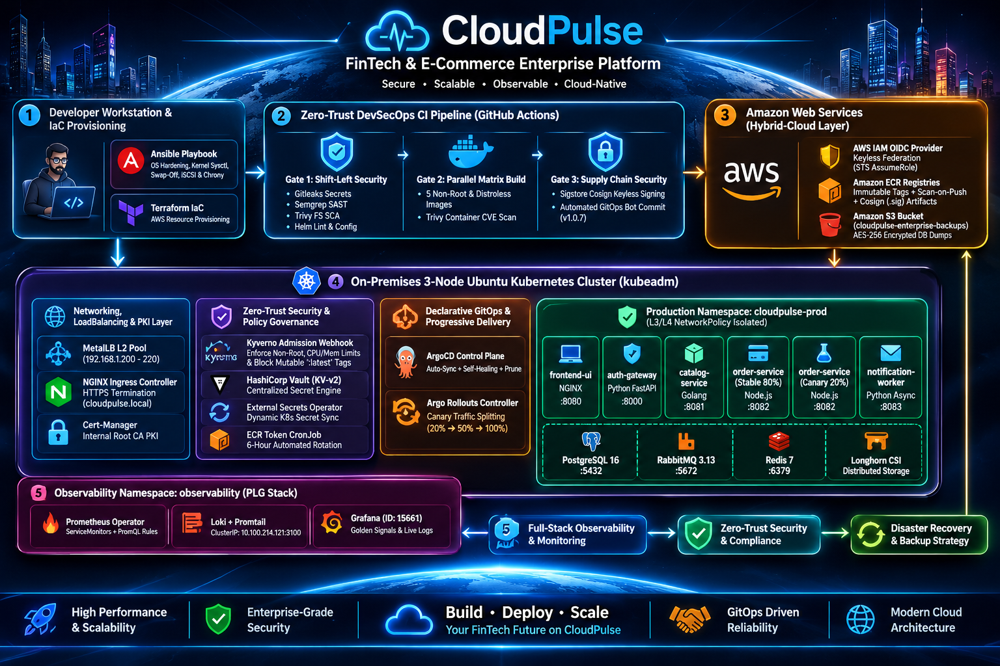
  <br>
  <em><b>Figure 1:</b> System Architecture Diagram </em>
</p>

## 🧰 3. Technology Stack

- **Cloud Provider & Hybrid Services:** Amazon Web Services (Amazon ECR, Amazon S3 with Server-Side Encryption `AES256`, AWS IAM OpenID Connect Federation)
- **Infrastructure as Code (IaC):** Terraform (`>= 1.5.0`) managing immutable ECR repositories, lifecycle policies, S3 backup storage, and GitHub OIDC trust roles
- **Configuration Management & OS Hardening:** Ansible Playbooks automating kernel parameter tuning (`vm.max_map_count`, `fs.inotify`, `ip_forward`), permanent swap removal, `chrony` NTP sync, and `open-iscsi` storage daemons
- **Container Orchestration:** 3-Node Bare-Metal Ubuntu Kubernetes Cluster (`kubeadm`, `containerd`, Calico CNI)
- **Bare-Metal Cloud Add-Ons:**
  - **LoadBalancer:** MetalLB (Layer 2 ARP Mode assigning physical network VIPs `192.168.1.200-220`)
  - **Ingress Routing:** NGINX Ingress Controller with Prometheus metrics enabled
  - **Distributed Block Storage:** Longhorn CSI (Synchronous block-level volume replication across worker nodes)
  - **PKI & TLS Automation:** Cert-Manager with a self-bootstrapped Internal Root Certificate Authority (`cloudpulse-ca-issuer`)
- **Polyglot Application Stack:** Python 3.12 (`FastAPI`, `Uvicorn`, `PyJWT`, `httpx`), Golang 1.22 (Static Binary on Google Distroless), Node.js 20 (`Express`, `pg`, `amqplib`, `prom-client`), Python Async Worker (`pika`), and Unprivileged NGINX (`1.27-alpine`)
- **Stateful Data & Messaging:** PostgreSQL 16 (`StatefulSet`), RabbitMQ 3.13 Management (`StatefulSet`), and Redis 7 (`Deployment`)
- **DevSecOps CI & Supply Chain Security:** GitHub Actions (Parallel Matrix Workflows), **Gitleaks** (Secret Scanning), **Semgrep** (SAST), **Trivy** (Filesystem SCA, Helm Misconfiguration, and Docker Image CVE Scanning), and **Sigstore Cosign** (Keyless OIDC Container Signing)
- **GitOps & Progressive Delivery:** Helm 3 (Custom Umbrella Chart), **ArgoCD** (Declarative GitOps with `selfHeal` and `prune`), and **Argo Rollouts** (Automated Canary traffic splitting)
- **Zero-Trust Security & Governance:** **HashiCorp Vault** (`KV-v2`), **External Secrets Operator (ESO)**, **Kyverno** (Admission Controller enforcing Non-Root execution, resource limits, and immutable image tags), and **Kubernetes NetworkPolicies** (Default-Deny + L3/L4 database isolation)
- **Full-Stack Observability & DR:** Prometheus Operator (`ServiceMonitor` & `PrometheusRule` CRDs), Grafana (Dashboard ID `15661`), Loki & Promtail (PLG Logging Stack), and Automated Kubernetes `CronJob` for PostgreSQL-to-S3 Disaster Recovery

---

## 📂 4. Repository Structure

The repository follows a modular, enterprise monorepo layout separating Ansible OS automation, Terraform cloud provisioning, Kubernetes platform add-ons, polyglot microservice source code, Helm packaging, and visual engineering evidence:

```text
cloudpulse-platform/
├── .github/
│   └── workflows/
│       └── devsecops-ci.yml              # 3-Gate Parallel Matrix DevSecOps CI & GitOps Auto-Updater
├── ansible/
│   ├── inventory.ini                     # 3-Node Kubernetes cluster inventory (Master + 2 Workers)
│   └── node-hardening.yml                # Kernel tuning, swap removal, iSCSI & Chrony provisioning
├── terraform/
│   └── main.tf                           # AWS ECR, Encrypted S3 Backup Bucket & GitHub OIDC IAM Role
├── services/
│   ├── auth-gateway/                     # Python FastAPI JWT Gateway (Non-Root Multi-Stage Dockerfile)
│   │   ├── Dockerfile
│   │   ├── main.py
│   │   └── requirements.txt
│   ├── catalog-service/                  # Golang Microservice (Google Distroless Static Binary)
│   │   ├── Dockerfile
│   │   ├── go.mod
│   │   └── main.go
│   ├── order-service/                    # Node.js Express + PostgreSQL + RabbitMQ + Prom Metrics
│   │   ├── Dockerfile
│   │   ├── package.json
│   │   └── server.js
│   ├── notification-worker/              # Python Async RabbitMQ Consumer + Health/Metrics Server
│   │   ├── Dockerfile
│   │   ├── requirements.txt
│   │   └── worker.py
│   └── frontend-ui/                      # Dark-Mode Enterprise FinTech UI on Unprivileged NGINX
│       ├── Dockerfile
│       ├── index.html
│       └── nginx.conf
├── helm/
│   └── cloudpulse-chart/                 # Custom Enterprise Umbrella Helm Chart
│       ├── Chart.yaml                    # Helm chart metadata
│       ├── values.yaml                   # Centralized declarative configuration & Canary tags (v1.0.7)
│       └── templates/
│           ├── external-secret.yaml      # ESO dynamic secret synchronization from HashiCorp Vault
│           ├── secrets.yaml              # Fallback Kubernetes Secret manifest
│           ├── postgresql.yaml           # StatefulSet for transactional order persistence
│           ├── redis-rabbitmq.yaml       # In-memory cache and asynchronous AMQP message broker
│           ├── microservices.yaml        # Hardened non-root Deployments with Probes & Limits
│           ├── order-rollout.yaml        # Argo Rollouts Canary strategy (20% -> 50% -> 100%)
│           ├── ingress.yaml              # HTTPS Ingress with automated Cert-Manager TLS
│           ├── network-policies.yaml     # Zero-Trust Default-Deny & Micro-Segmentation policies
│           ├── servicemonitors.yaml      # Prometheus ServiceMonitor & PromQL Alerting Rules
│           └── db-backup-cronjob.yaml    # Nightly PostgreSQL dump & encrypted AWS S3 uploader
├── k8s-platform/
│   ├── metallb-config.yaml               # Bare-Metal L2 LoadBalancer IP Address Pool
│   ├── cluster-issuer.yaml               # Internal PKI Root CA & Cert-Manager ClusterIssuer
│   ├── ecr-credentials-sync.yaml         # RBAC CronJob for automated 6-hour AWS ECR token rotation
│   ├── init-vault.sh                     # Automated Vault initialization, unsealing & KV-v2 seeding
│   ├── vault-secret-store.yaml           # ESO ClusterSecretStore linked to HashiCorp Vault
│   ├── kyverno-policies.yaml             # Enforce-mode Admission Policies (Non-Root, Limits, No-Latest)
│   ├── argocd-application.yaml           # Declarative ArgoCD Application with Self-Healing enabled
│   └── observability-values.yaml         # Production tuning for Prometheus, Grafana & Loki
├── docs/
│   └── screenshots/                      # 25 End-to-End Implementation & Verification Screenshots
├── .gitleaks.toml                        # Gitleaks secret scanning allowlist & ruleset
├── .gitignore                            # Excludes Terraform state files and local Vault keys
└── README.md                             # Enterprise Architecture & Execution Documentation

```

## 📋 5. Prerequisites & Cluster Topology

### 🖥️ Bare-Metal / VM Cluster Topology
The platform is deployed across a 3-Node Ubuntu Linux `kubeadm` cluster networked on a private L2 subnet:

| Hostname | Cluster Role | IP Address | OS / Kernel | Provisioned Components |
| :--- | :--- | :--- | :--- | :--- |
| **`k8s-master-01`** | Control Plane + Bastion | `192.168.1.10` | Ubuntu 22.04 / 24.04 LTS | `kube-apiserver`, `etcd`, Terraform, Ansible, Helm, AWS CLI |
| **`k8s-worker-01`** | Compute & Storage Worker 1 | `192.168.1.11` | Ubuntu 22.04 / 24.04 LTS | Polyglot Microservices, Stateful Workloads, Promtail, Calico |
| **`k8s-worker-02`** | Compute & Storage Worker 2 | `192.168.1.12` | Ubuntu 22.04 / 24.04 LTS | Polyglot Microservices, Observability Stack, Longhorn CSI |
| **MetalLB VIP Pool** | Virtual LoadBalancer IPs | `192.168.1.200 - 220` | L2 ARP Broadcast | External IP allocation for `ingress-nginx-controller` |

### 🛠️ Required CLI Tools & Cloud Accounts
- **Active AWS Account** with permissions to provision ECR, S3, and IAM OIDC resources
- [**Terraform CLI (`>= 1.5.0`)**](https://developer.hashicorp.com/terraform/downloads) & [**Ansible (`>= 2.15`)**](https://docs.ansible.com/)
- [**Kubernetes CLI (`kubectl`)**](https://kubernetes.io/docs/tasks/tools/) & [**Helm 3 CLI**](https://helm.sh/docs/intro/install/)
- [**Argo Rollouts CLI Plugin (`kubectl-argo-rollouts`)**](https://argoproj.github.io/argo-rollouts/installation/)
- [**Docker Engine**](https://docs.docker.com/engine/install/), [**Trivy Scanner**](https://aquasecurity.github.io/trivy/), and [**Cosign**](https://docs.sigstore.dev/cosign/system_config/installation/)


## ⚙️ 6. Execution & Deployment Guide

This guide walks through reproducing the entire **CloudPulse** hybrid-cloud platform across all 5 architectural phases.

### 🔧 Phase 6.1: OS Hardening via Ansible & AWS Cloud Provisioning via Terraform

**1. Clone the repository and execute the Ansible node-hardening playbook:**
```bash
git clone [https://github.com/Ahmed-Abbas-1/cloudpulse-microservices.git](https://github.com/Ahmed-Abbas-1/cloudpulse-microservices.git)
cd cloudpulse-microservices/ansible
```
# Harden all 3 Ubuntu nodes (disable swap, load overlay/br_netfilter/iscsi_tcp, tune sysctl & start chrony)
```bash
ansible-playbook -i inventory.ini node-hardening.yml
```

2. Provision AWS ECR Repositories, Encrypted S3 Backup Bucket, and GitHub OIDC Role:
```bash
cd ../terraform
terraform init
terraform apply -var="github_org_or_user=Ahmed-Abbas-1" -auto-approve

# Retrieve the provisioned GitHub Actions OIDC Role ARN and S3 Backup Bucket Name
terraform output github_actions_role_arn
terraform output s3_backup_bucket_name
```

🌐 Phase 6.2: Transforming Bare-Metal kubeadm with MetalLB, Ingress, Longhorn & Cert-Manager
1. Enable Strict ARP in kube-proxy and deploy MetalLB L2 LoadBalancer:
```bash
kubectl get configmap kube-proxy -n kube-system -o yaml | \
  sed -e "s/strictARP: false/strictARP: true/" | kubectl apply -f - -n kube-system

kubectl apply -f [https://raw.githubusercontent.com/metallb/metallb/v0.14.8/config/manifests/metallb-native.yaml](https://raw.githubusercontent.com/metallb/metallb/v0.14.8/config/manifests/metallb-native.yaml)
kubectl apply -f ../k8s-platform/metallb-config.yaml
```

2. Deploy NGINX Ingress Controller, Longhorn CSI, and Cert-Manager Internal PKI:
```bash
# Install NGINX Ingress Controller exposed via MetalLB LoadBalancer IP
helm upgrade --install ingress-nginx ingress-nginx/ingress-nginx \
  --namespace ingress-nginx --create-namespace \
  --set controller.service.type=LoadBalancer \
  --set controller.metrics.enabled=true --wait

# Install Longhorn Distributed Block Storage (2 Replicas across Worker Nodes)
helm upgrade --install longhorn longhorn/longhorn \
  --namespace longhorn-system --create-namespace \
  --set defaultSettings.defaultReplicaCount=2 --wait

# Install Cert-Manager and bootstrap the CloudPulse Internal Root CA
helm upgrade --install cert-manager jetstack/cert-manager \
  --namespace cert-manager --create-namespace --set crds.enabled=true --wait
kubectl apply -f ../k8s-platform/cluster-issuer.yaml
```

🔐 Phase 6.3: Zero-Trust Security (HashiCorp Vault, ESO, Kyverno & NetworkPolicies)
1. Deploy and initialize HashiCorp Vault + External Secrets Operator (ESO):
```bash
helm upgrade --install vault hashicorp/vault \
  --namespace security-system --create-namespace \
  --set "ui.enabled=true" --set "injector.enabled=false" --wait

# Initialize Vault, unseal, enable KV-v2, and seed production secrets
chmod +x ../k8s-platform/init-vault.sh
../k8s-platform/init-vault.sh

# Install ESO and bind ClusterSecretStore to Vault
helm upgrade --install external-secrets external-secrets/external-secrets \
  --namespace security-system --set installCRDs=true --wait
kubectl apply -f ../k8s-platform/vault-secret-store.yaml
```

2. Enforce Kyverno Admission Governance Policies:
```bash
helm upgrade --install kyverno kyverno/kyverno \
  --namespace kyverno --create-namespace --wait

# Enforce non-root execution, mandatory CPU/Memory limits, and immutable image tags
kubectl apply -f ../k8s-platform/kyverno-policies.yaml

# Verify policy enforcement by simulating an unauthorized root pod deployment (Blocked by Webhook)
kubectl apply -f ../k8s-platform/rogue-pod-test.yaml
```

🚀 Phase 6.4: GitOps Control Plane (ArgoCD) & Progressive Canary Delivery (Argo Rollouts)
1. Deploy ArgoCD, Argo Rollouts, and the Custom CloudPulse Helm Chart:
```bash
helm upgrade --install argocd argo/argo-cd \
  --namespace argocd --create-namespace --set server.extraArgs="{--insecure}" --wait

helm upgrade --install argo-rollouts argo/argo-rollouts \
  --namespace argo-rollouts --create-namespace --set dashboard.enabled=true --wait

# Deploy the CloudPulse production release and register declarative ArgoCD tracking
helm upgrade --install cloudpulse ../helm/cloudpulse-chart \
  --namespace cloudpulse-prod --create-namespace --wait
kubectl apply -f ../k8s-platform/argocd-application.yaml
```

2. Trigger and monitor a Progressive Canary Deployment (20% ➔ 50% ➔ 100%):
```bash
# Watch live traffic splitting across stable and canary ReplicaSets
kubectl argo rollouts get rollout order-service -n cloudpulse-prod --watch

# Launch the visual Argo Rollouts Dashboard
kubectl argo rollouts dashboard -n cloudpulse-prod --port 3100
```

📊 Phase 6.5: Full-Stack Observability (Prometheus, Grafana, Loki) & AWS S3 Disaster Recovery
1. Deploy the Observability Stack and custom ServiceMonitor / PrometheusRule CRDs:
```bash
helm upgrade --install kube-prometheus-stack prometheus-community/kube-prometheus-stack \
  --namespace observability --create-namespace \
  -f ../k8s-platform/observability-values.yaml --wait

helm upgrade --install loki grafana/loki-stack \
  --namespace observability --set promtail.enabled=true --wait
```

2. Execute and verify encrypted PostgreSQL Disaster Recovery backups to Amazon S3:
```bash
# Trigger an on-demand backup job from the Kubernetes CronJob
kubectl create job --from=cronjob/postgresql-s3-disaster-recovery manual-dr-backup-01 -n cloudpulse-prod

# Verify AES-256 encrypted backup artifacts inside the AWS S3 bucket
aws s3 ls s3://cloudpulse-enterprise-backups-bf83ff9b/postgres-backups/ --human-readable
```

## 🚀 7. Implementation Stages & Verification (Visual Evidence)

This section provides comprehensive visual verification across every layer of the **CloudPulse** platform, proving end-to-end operational readiness from bare-metal kernel hardening to AWS cloud disaster recovery.

---

### 🏗️ Part A: Hybrid-Cloud Infrastructure & Bare-Metal Kubernetes Foundation

#### Stage 1: Automated Node Hardening & Kernel Tuning (Ansible)
Executed an idempotent Ansible playbook across all three Ubuntu nodes (`k8s-master-01`, `k8s-worker-01`, `k8s-worker-02`) to disable swap permanently, configure kernel modules (`overlay`, `br_netfilter`, `iscsi_tcp`), tune sysctl limits, and synchronize clocks via `chrony`.
<p align="center">
  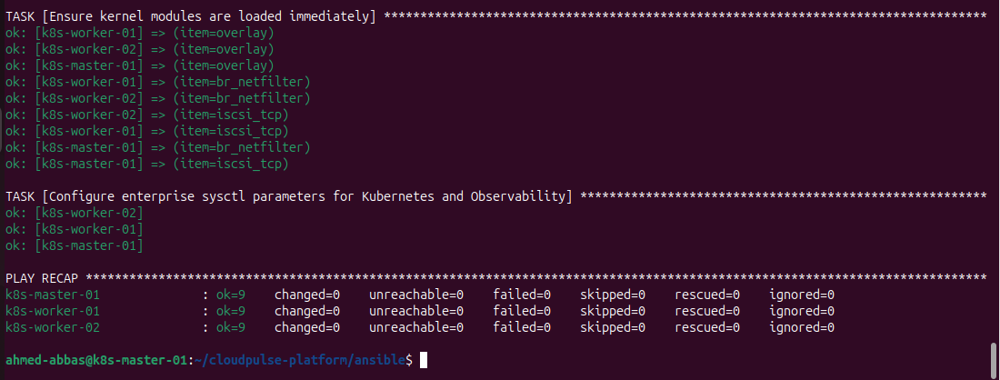
  <br>
  <em><b>Figure 2:</b> Ansible playbook execution completing across the 3-node Kubernetes cluster with zero failures.</em>
</p>

#### Stage 2: AWS Cloud Provisioning & Keyless OIDC Federation (Terraform)
Provisioned 5 immutable Amazon ECR repositories with `scan_on_push` enabled, an AES-256 encrypted Amazon S3 backup bucket (`cloudpulse-enterprise-backups-bf83ff9b`), and an AWS IAM OpenID Connect (OIDC) trust role for passwordless GitHub Actions authentication.
<p align="center">
  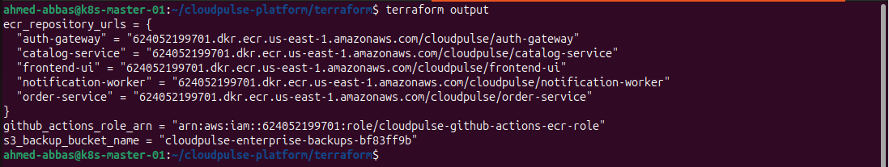
  <br>
  <em><b>Figure 3:</b> Terraform outputs confirming the creation of the S3 DR bucket, ECR registries, and GitHub OIDC IAM Role ARN.</em>
</p>

#### Stage 3: Bare-Metal L2 LoadBalancing (MetalLB) & NGINX Ingress Controller
Transformed the bare-metal `kubeadm` cluster by deploying MetalLB in Layer-2 ARP mode, dynamically assigning an external Virtual IP (`192.168.1.200`) to the NGINX Ingress Controller.
<p align="center">
  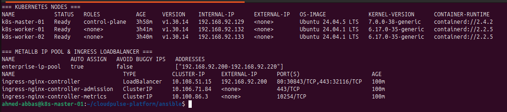
  <br>
  <em><b>Figure 4:</b> Kubernetes nodes in 'Ready' state alongside MetalLB IP address pool allocation to the NGINX Ingress LoadBalancer.</em>
</p>

#### Stage 4: Cloud-Native Distributed Block Storage (Longhorn CSI)
Deployed Longhorn CSI across the worker nodes to provide synchronous block-level replicated persistent storage (`StorageClass: longhorn`) for stateful workloads.
<p align="center">
  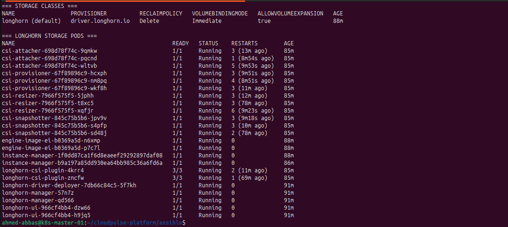
  <br>
  <em><b>Figure 5:</b> Longhorn distributed storage system pods running with 'longhorn' configured as the default StorageClass.</em>
</p>

#### Stage 5: Automated Internal PKI & TLS Certificate Management (Cert-Manager)
Bootstrapped a custom Internal Root Certificate Authority (`cloudpulse-ca-issuer`) using Cert-Manager to automatically issue and renew X.509 TLS certificates for cluster Ingresses.
<p align="center">
  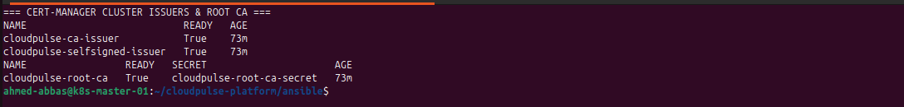
  <br>
  <em><b>Figure 6:</b> Cert-Manager ClusterIssuers and the CloudPulse Root CA certificate verified in 'Ready = True' state.</em>
</p>

#### Stage 6: GitOps Control Plane Initialization (ArgoCD)
Deployed the ArgoCD control plane to continuously reconcile the cluster state against the declarative Helm manifests stored in GitHub.
<p align="center">
  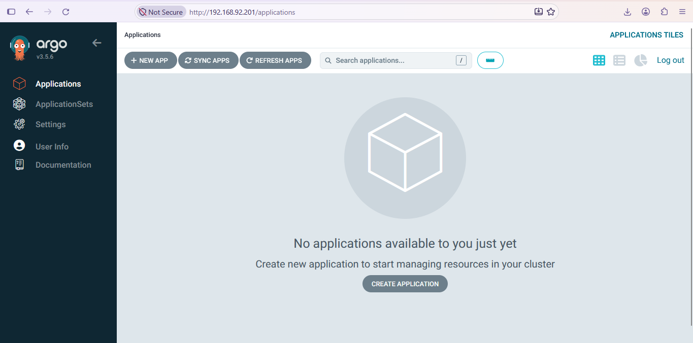
  <br>
  <em><b>Figure 7:</b> ArgoCD web control plane initialized and ready for declarative GitOps application onboarding.</em>
</p>

---

### 🐳 Part B: Polyglot Microservices, Helm Packaging & Stateful Workloads

#### Stage 7: Multi-Stage & Distroless Container Registries (Amazon ECR)
Built and pushed hardened, non-root container images for all 5 polyglot microservices (`auth-gateway`, `catalog-service`, `order-service`, `notification-worker`, `frontend-ui`) to Amazon ECR with automated vulnerability scanning.
<p align="center">
  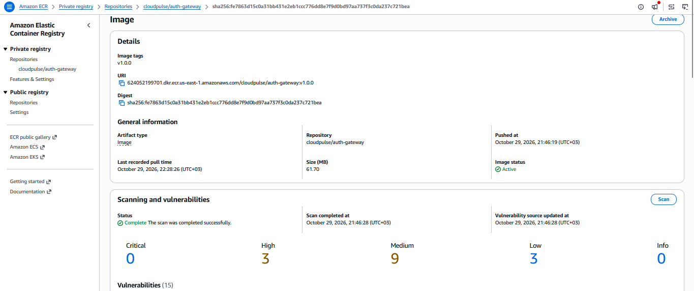
  <br>
  <em><b>Figure 8:</b> Amazon ECR repositories storing immutable microservice images with completed security scan statuses.</em>
</p>

#### Stage 8: Full-Stack Helm Deployment & Stateful Persistence
Packaged the entire platform into an enterprise umbrella Helm chart (`cloudpulse-chart`) and deployed all microservices, message brokers, and databases into the isolated `cloudpulse-prod` namespace.
<p align="center">
  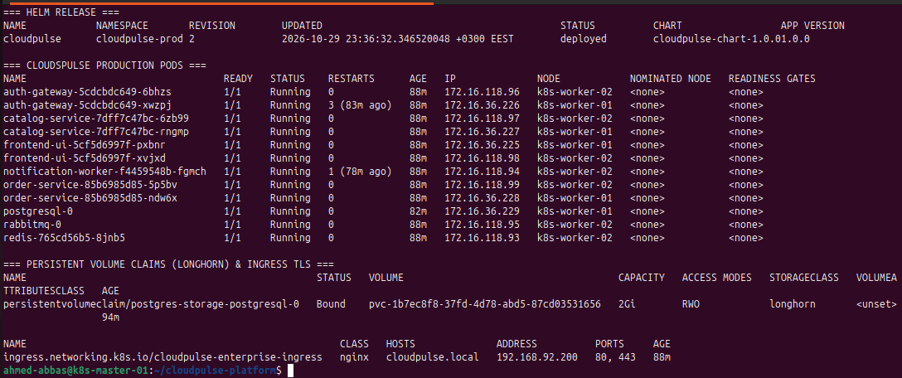
  <br>
  <em><b>Figure 9:</b> Active Helm release, running non-root microservice pods, bound PVCs, and TLS-secured Ingress in 'cloudpulse-prod'.</em>
</p>

#### Stage 9: Progressive Delivery Resource Definition (Argo Rollouts)
Configured `order-service` as an `argoproj.io/v1alpha1` `Rollout` resource rather than a standard Deployment to enable automated Canary traffic shifting.
<p align="center">
  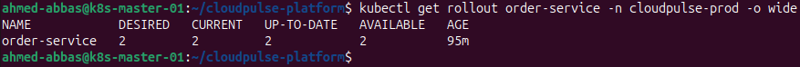
  <br>
  <em><b>Figure 10:</b> Argo Rollout controller managing the 'order-service' workload in a healthy steady state.</em>
</p>

#### Stage 10: Asynchronous Event-Driven Architecture (RabbitMQ & Python Worker)
Verified end-to-end asynchronous decoupling: financial orders persisted in PostgreSQL publish `ORDER_CREATED` events to RabbitMQ, which are immediately consumed and acknowledged by `notification-worker`.
<p align="center">
  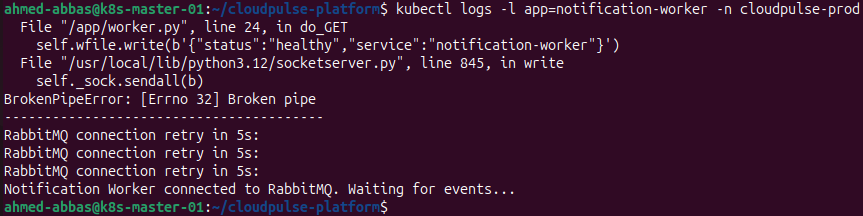
  <br>
  <em><b>Figure 11:</b> Live audit logs from 'notification-worker' confirming real-time consumption of RabbitMQ order events.</em>
</p>

#### Stage 11: Live CloudPulse FinTech Platform over HTTPS Ingress
Accessed the production web interface at `https://cloudpulse.local`, validating FastAPI JWT authentication, Golang catalog retrieval, PostgreSQL order creation, and live Canary version telemetry.
<p align="center">
  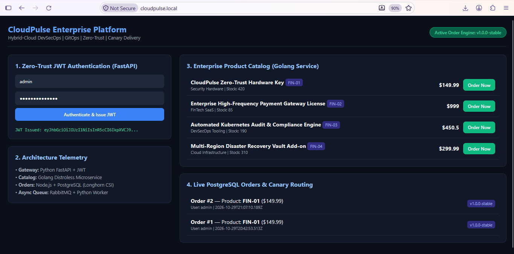
  <br>
  <em><b>Figure 12:</b> CloudPulse Enterprise FinTech UI running over HTTPS, displaying live JWT issuance, product catalog, and processed PostgreSQL orders.</em>
</p>

---

### 🛡️ Part C: Enterprise Zero-Trust Security & Policy Governance

#### Stage 12: Centralized Secret Management (HashiCorp Vault KV-v2)
Initialized and unsealed HashiCorp Vault in `security-system`, storing sensitive production credentials (`JWT_SECRET`, `POSTGRES_USER`, `POSTGRES_PASSWORD`, `POSTGRES_DB`) inside the versioned `secret/cloudpulse/prod` KV-v2 engine.
<p align="center">
  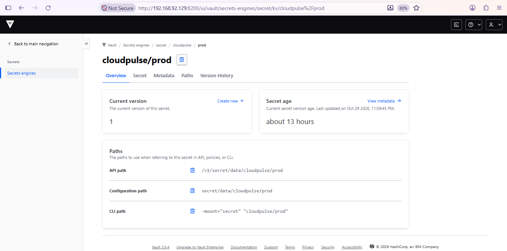
  <br>
  <em><b>Figure 13:</b> HashiCorp Vault UI displaying centralized production secrets managed under 'secret/cloudpulse/prod'.</em>
</p>

#### Stage 13: Dynamic Runtime Secret Injection (External Secrets Operator)
Connected Kubernetes to HashiCorp Vault via a `ClusterSecretStore` and `ExternalSecret` resource, dynamically generating `cloudpulse-app-secrets` in `cloudpulse-prod` without storing any sensitive strings in Git.
<p align="center">
  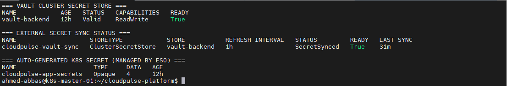
  <br>
  <em><b>Figure 14:</b> External Secrets Operator verifying 'STATUS: SecretSynced' and 'READY: True' from the Vault backend.</em>
</p>

#### Stage 14: Policy-as-Code Admission Governance (Kyverno)
Deployed three cluster-wide Kyverno policies in strict `Enforce` mode: `disallow-root-microservices`, `require-pod-resource-limits`, and `disallow-latest-tag`.
<p align="center">
  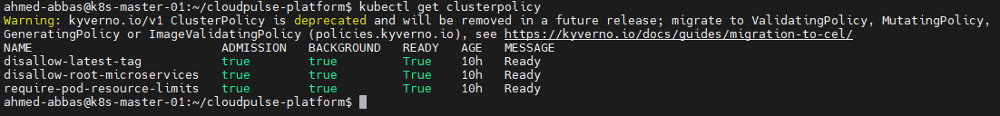
  <br>
  <em><b>Figure 15:</b> Kyverno ClusterPolicies active in 'Enforce' mode across the production namespace.</em>
</p>

#### Stage 15: Live Security Breach Simulation (Kyverno Blocking Rogue Pod)
Simulated an unauthorized deployment of a privileged container (`nginx:latest` running as `root` without CPU/Memory limits). The Kyverno admission webhook immediately intercepted and rejected the API request.
<p align="center">
  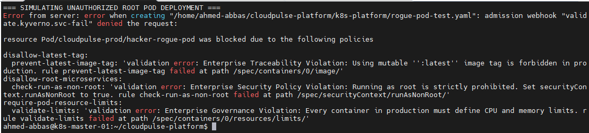
  <br>
  <em><b>Figure 16:</b> Kyverno admission webhook actively blocking the creation of a non-compliant root pod in 'cloudpulse-prod'.</em>
</p>

#### Stage 16: Zero-Trust L3/L4 Micro-Segmentation (Kubernetes NetworkPolicies)
Enforced a `default-deny-all-ingress` baseline policy alongside granular allowlist policies ensuring `postgresql:5432` only accepts TCP connections originating from `order-service` pods.
<p align="center">
  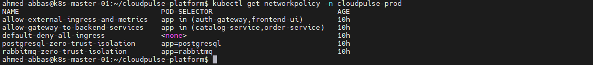
  <br>
  <em><b>Figure 17:</b> Zero-Trust Kubernetes NetworkPolicies isolating frontend, gateway, backend, message broker, and database tiers.</em>
</p>

---

### ⚙️ Part D: Shift-Left DevSecOps CI Pipeline, Cosign Signing & Canary Rollouts

#### Stage 17: Parallel Matrix DevSecOps CI Pipeline (GitHub Actions)
Engineered a 3-Gate automated workflow executing Gitleaks, Semgrep SAST, Trivy SCA/Config scans, parallel matrix Docker builds for all 5 microservices, keyless AWS OIDC ECR pushes, and automated GitOps manifest updates.
<p align="center">
  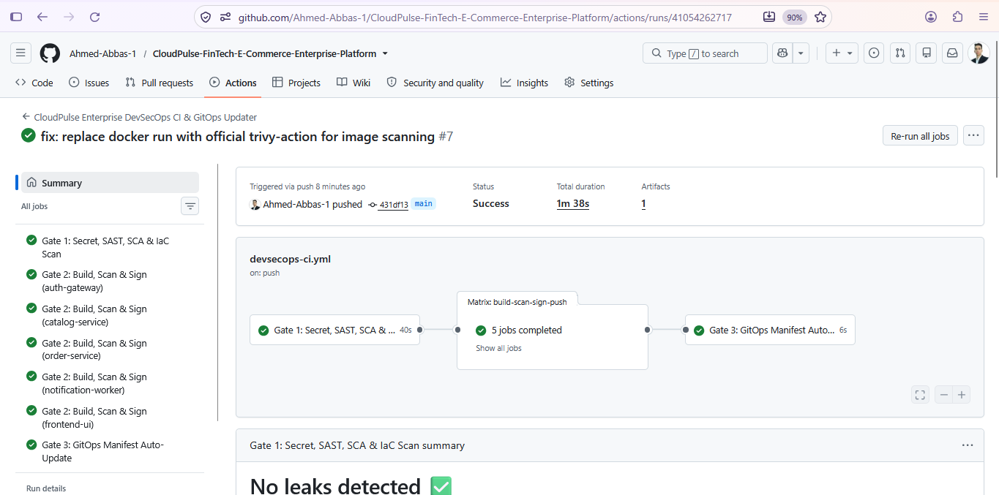
  <br>
  <em><b>Figure 18:</b> GitHub Actions DevSecOps pipeline completing all security gates, parallel builds, and GitOps promotion.</em>
</p>

#### Stage 18: Keyless AWS OIDC, Trivy Image Scanning & Cosign Verification Logs
Verified detailed execution logs confirming temporary AWS STS credential assumption via OIDC, zero unfixed critical vulnerabilities in Trivy, and keyless container signing via Sigstore Cosign.
<p align="center">
  
  <br>
  <em><b>Figure 19:</b> CI execution logs demonstrating Shift-Left security scanning, keyless OIDC authentication, and Cosign signing.</em>
</p>

#### Stage 19: Cryptographic Supply-Chain Signatures in Amazon ECR
Confirmed that Sigstore Cosign cryptographic signature artifacts (`.sig`) are stored alongside the immutable microservice container images inside Amazon ECR.
<p align="center">
  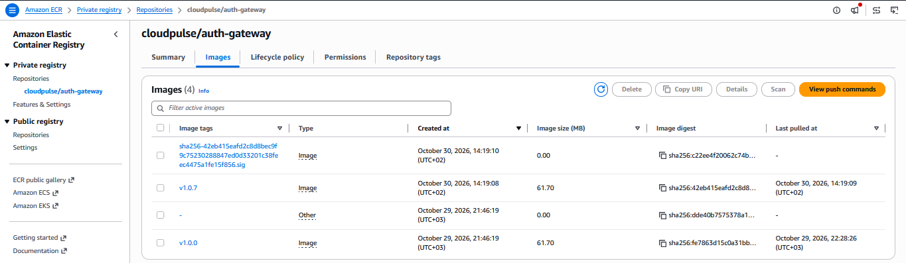
  <br>
  <em><b>Figure 20:</b> Amazon ECR repository displaying both the immutable container image and its cryptographic Cosign '.sig' artifact.</em>
</p>

#### Stage 20: Declarative GitOps Topology & Automated Self-Healing (ArgoCD)
Onboarded `cloudpulse-enterprise-prod` into ArgoCD with automated sync, pruning, and self-healing enabled, reconciling all 18 Kubernetes resources from GitHub.
<p align="center">
  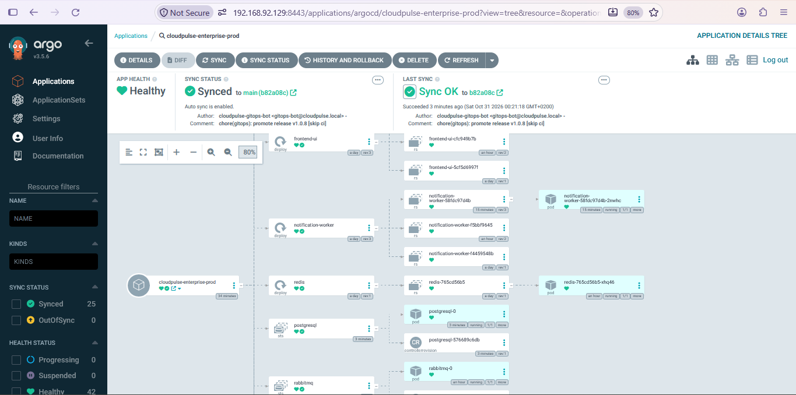
  <br>
  <em><b>Figure 21:</b> ArgoCD application topology tree showing all microservices, StatefulSets, Ingress, and NetworkPolicies in 'Synced & Healthy' state.</em>
</p>

#### Stage 21: Zero-Downtime Canary Progression via CLI (Argo Rollouts)
Triggered a Canary release (`v2.0.0-canary`) for `order-service`, observing controlled traffic splitting (`20%` Canary / `80%` Stable) via the Argo Rollouts CLI plugin.
<p align="center">
  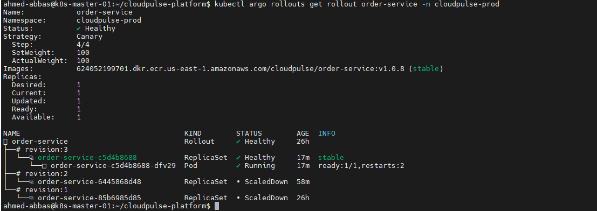
  <br>
  <em><b>Figure 22:</b> Argo Rollouts CLI displaying live Canary revision progression and traffic weight distribution.</em>
</p>

#### Stage 22: Visual Progressive Delivery Dashboard (Argo Rollouts UI)
Inspected the progressive Canary step execution (`setWeight: 20% ➔ pause ➔ setWeight: 50% ➔ 100%`) through the Argo Rollouts web dashboard.
<p align="center">
  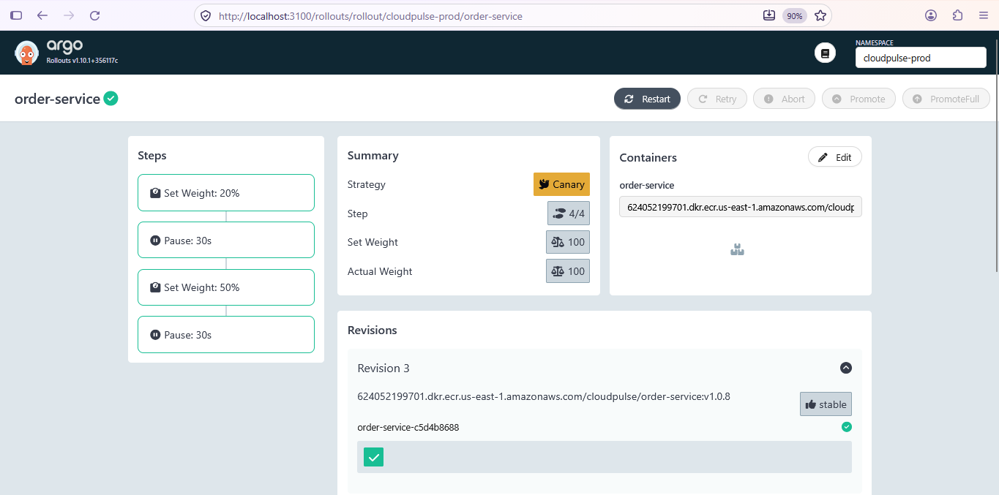
  <br>
  <em><b>Figure 23:</b> Argo Rollouts visual dashboard illustrating real-time Canary step progression and ReplicaSet traffic weights.</em>
</p>

---

### 📊 Part E: Full-Stack Observability & Cloud Disaster Recovery

#### Stage 23: Custom Microservice Telemetry Discovery (Prometheus `ServiceMonitor`)
Configured Prometheus Operator `ServiceMonitor` CRDs to automatically discover and scrape `/metrics` endpoints across `auth-gateway`, `catalog-service`, and `order-service` every 15 seconds.
<p align="center">
  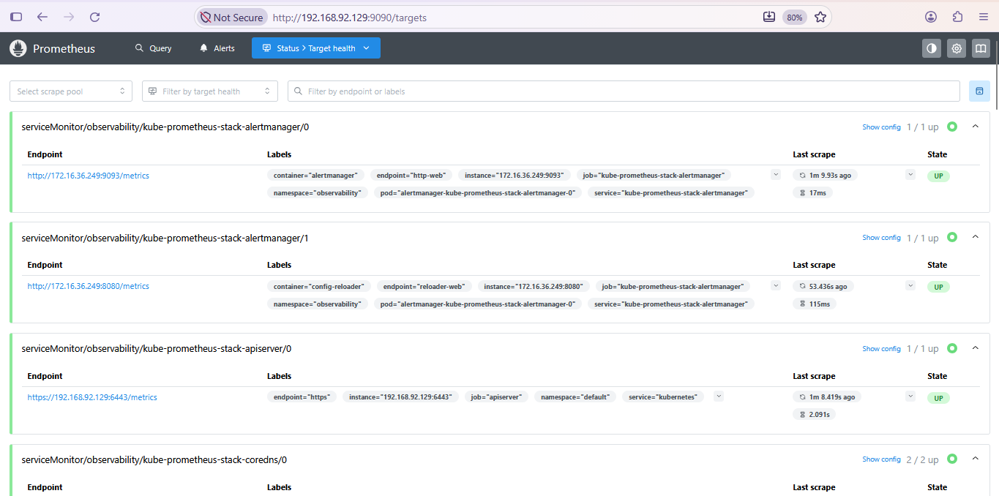
  <br>
  <em><b>Figure 24:</b> Prometheus Targets interface confirming 100% 'UP' state across all CloudPulse microservice endpoints.</em>
</p>

#### Stage 24: Golden Signals & Kubernetes Resource Visualization (Grafana)
Visualized real-time CPU, memory working sets, network throughput, and pod readiness for the `cloudpulse-prod` namespace using Grafana (Dashboard ID `15661`).
<p align="center">
  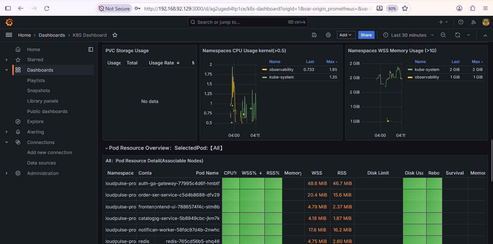
  <br>
  <em><b>Figure 25:</b> Grafana dashboard visualizing real-time Kubernetes compute and network telemetry for 'cloudpulse-prod'.</em>
</p>

#### Stage 25: Automated PostgreSQL Disaster Recovery to Encrypted AWS S3
Executed the automated disaster recovery pipeline that streams a live `pg_dump` from the `postgresql-0` StatefulSet, compresses it via `gzip`, and uploads it with `AES-256` Server-Side Encryption to Amazon S3 (`s3://cloudpulse-enterprise-backups-bf83ff9b/postgres-backups/`).
<p align="center">
  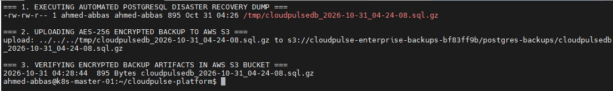
  <br>
  <em><b>Figure 26:</b> Verification of the Kubernetes DR backup job and the resulting AES-256 encrypted SQL dumps stored inside Amazon S3.</em>
</p>


## ⚠️ 8. Engineering Challenges, Root-Cause Analysis (RCA) & Solutions

Operating a multi-layered Hybrid-Cloud DevSecOps platform on a 3-node bare-metal `kubeadm` cluster surfaced complex, real-world production incidents. Below is the executive troubleshooting matrix followed by the deep-dive Root-Cause Analysis (RCA) of all 14 engineering challenges resolved during platform implementation:

### 📋 Executive Troubleshooting Matrix

| # | 🔴 Production Incident / Challenge | 🟢 Architectural Resolution (SRE Approach) |
| :-: | :--- | :--- |
| **1** | **Control Plane OOM & `kube-apiserver` Connection Refused** | Purged dead CRI sandboxes (`crictl rmp -a -f`), restarted `containerd`/`kubelet`, applied resource right-sizing (`replicas: 1`), and used `--server-side` / `--validate=false` flags. |
| **2** | **Stale Calico CNI State (`ContainerCreating`) & Namespace Corruption** | Flushed worker CNI states via `systemctl restart containerd kubelet` and scheduled a clean `grafana-rescue` pod to acquire an uncorrupted network namespace. |
| **3** | **Infinite `Terminating` Pods & Locked PVC Finalizers** | Force-purged orphaned pods (`--force --grace-period=0`) and stripped `kubernetes.io/pvc-protection` finalizers via `kubectl patch`. |
| **4** | **Kyverno Admission Webhook Circular Deadlock (`svc-fail`)** | Broke the control-plane deadlock on reboot by deleting Kyverno's `ValidatingWebhookConfiguration` and `MutatingWebhookConfiguration` before healing pods. |
| **5** | **GitOps "Source of Truth" Conflict (ArgoCD Overwriting Fixes)** | Committed storage optimizations (`emptyDir`) directly to `postgresql.yaml` and `values.yaml` in GitHub so ArgoCD (`selfHeal: true`) reconciled the desired state. |
| **6** | **StatefulSet Immutable Fields Violation (`StatefulSet.apps is invalid`)** | Deleted the existing `postgresql` StatefulSet object prior to syncing ArgoCD, enabling clean recreation with the updated volume architecture. |
| **7** | **ArgoCD Redis Cache Corruption (`Init:CrashLoopBackOff`)** | Executed a namespace-wide pod reset (`kubectl delete pods --all -n argocd`) after an abrupt VM power-off to re-initialize clean ephemeral volumes. |
| **8** | **Git Rebase Conflict with Automated GitOps CI Bot (`v1.0.7`)** | Executed `git pull --rebase origin main` and resolved `values.yaml` conflicts to preserve both the CI bot's `v1.0.7` tags and S3 backup configurations. |
| **9** | **Helm Upgrade `Context Deadline Exceeded` (`--wait` Trap)** | Remediated pending workloads in `cloudpulse-prod` before running `helm upgrade --wait`, preventing atomic timer rollbacks. |
| **10** | **Barebone `grafana-rescue` & Dashboard `15661` Provisioning** | Bypassed hanging sidecar init containers by deploying a standalone Grafana instance and importing Kubernetes Dashboard **ID: 15661** filtered to `cloudpulse-prod`. |
| **11** | **CoreDNS Resolution Lag Under High CPU Load** | Bypassed internal DNS lookup timeouts by wiring Grafana directly to Loki's immutable ClusterIP (`http://10.100.214.121:3100`). |
| **12** | **Zombie Port-Forward Sockets & Multi-Hop SSH Tunneling** | Cleared zombie listeners (`sudo fuser -k 8443/tcp`, `pkill kubectl`), port-forwarded directly to pods (`3001:3000`), and established `ssh -L` local tunnels. |
| **13** | **Ansible SSH Key Agent Mismatch (`id_ed25519` & `sshpass`)** | Explicitly loaded the Ed25519 identity (`ssh-add ~/.ssh/id_ed25519`) and integrated `sshpass` (`-k -K`) for non-interactive privilege escalation. |
| **14** | **Off-Site Database Durability & AWS S3 AES-256 Verification** | Streamed compressed `pg_dump` artifacts from `postgresql-0` directly to `s3://cloudpulse-enterprise-backups-bf83ff9b/postgres-backups/` with `--sse AES256`. |

---

### 🔍 Deep-Dive Root-Cause Analysis (Click to expand detailed incident logs)

<details>
  <summary><b>Category 1: Kubernetes Control Plane, CRI & Node-Level Recovery (Incidents 1 – 3)</b></summary>
  <br>

  #### 1. Control Plane OOM & `kube-apiserver` Connection Refused
  * **Symptom:** Executing `kubectl` commands returned `The connection to the server was refused` and `Client.Timeout exceeded while awaiting headers` during heavy Helm deployments.
  * **Root Cause:** Running Longhorn CSI, Kyverno, Vault, ArgoCD, and the Observability stack concurrently exhausted Master Node memory (OOM), causing `kube-apiserver` and `etcd` probes to fail.
  * **Engineering Resolution:**
    1. Purged dead Container Runtime Interface (CRI) sandboxes from the root level using `sudo crictl rmp -a -f`.
    2. Restarted the node runtime engines via `sudo systemctl restart containerd kubelet`.
    3. Implemented a **Resource Hibernation & Right-Sizing Strategy**, scaling down non-essential controllers and reducing microservice replicas (`replicas: 1`) in `values.yaml`.
    4. Bypassed heavy client-side OpenAPI schema validation bottlenecks under load using `--validate=false` and `--server-side` apply flags for large CRD payloads.

  #### 2. Worker Node Stale CNI State (`ContainerCreating`) & Network Namespace Corruption
  * **Symptom:** Following an emergency VM hard reboot, newly scheduled pods hung indefinitely in `Pending` and `ContainerCreating` despite images being pre-pulled. Additionally, the Grafana pod on `k8s-worker-02` threw `failed to connect to localhost:3000 inside namespace`.
  * **Root Cause:** Ungraceful VM shutdowns left corrupted virtual ethernet (`veth`) pairs and stale Calico CNI network namespaces on the worker nodes.
  * **Engineering Resolution:**
    1. Executed SSH recovery across worker nodes to flush stale runtime states: `sudo systemctl restart containerd && sudo systemctl restart kubelet`.
    2. Circumvented the corrupted CNI network namespace on `k8s-worker-02` by scheduling a clean standalone `grafana-rescue` pod, which acquired a healthy network namespace and IP allocation.

  #### 3. Infinite `Terminating` Pods & Deadlocked PVC Protection Finalizers
  * **Symptom:** Orphaned pods (such as `argocd-dex-server`) hung in a permanent `Terminating` state, while deleting the PostgreSQL `PersistentVolumeClaim` froze the terminal indefinitely.
  * **Root Cause:** Temporary node unresponsiveness prevented `kubelet` from confirming process termination, and the `kubernetes.io/pvc-protection` finalizer blocked PVC removal while storage bindings were being reconfigured.
  * **Engineering Resolution:**
    1. Force-purged orphaned pods from `etcd`: `kubectl delete pod <pod-name> --force --grace-period=0`.
    2. Patched the locked PVCs and CRDs to strip blocking finalizers: `kubectl patch pvc <pvc-name> -n cloudpulse-prod -p '{"metadata":{"finalizers":null}}' --type=merge`.
</details>

<details>
  <summary><b>Category 2: Zero-Trust Admission Control & Security Governance (Incident 4)</b></summary>
  <br>

  #### 4. Kyverno Admission Webhook Circular Deadlock (`validate.kyverno.svc-fail`)
  * **Symptom:** Attempting to delete stuck pods or apply recovery manifests failed with `Internal error occurred: failed calling webhook "validate.kyverno.svc-fail": connection refused`.
  * **Root Cause:** After cluster reboot, the `kube-apiserver` intercepted every API mutation to validate it against Kyverno's webhook service, which was itself stuck waiting for cluster resources—creating a classic control-plane deadlock.
  * **Engineering Resolution:** Broke the circular dependency by temporarily removing the validating and mutating webhook configurations (`kubectl delete validatingwebhookconfigurations,mutatingwebhookconfigurations -l webhook.kyverno.io/managed-by=kyverno`), allowing the control plane to heal before re-enforcing policies.
</details>

<details>
  <summary><b>Category 3: GitOps State Synchronization, Stateful Workloads & CI/CD Race Conditions (Incidents 5 – 9)</b></summary>
  <br>

  #### 5. GitOps "Source of Truth" Conflict (ArgoCD Overwriting Manual Fixes)
  * **Symptom:** After manually migrating `postgresql` from Longhorn PVCs to a lightweight local `emptyDir` volume on the cluster, the pod immediately reverted to `Pending` with `unbound immediate PersistentVolumeClaims`.
  * **Root Cause:** ArgoCD had `selfHeal: true` enabled, detecting the manual cluster optimization as "Configuration Drift" and immediately overwriting it with the old PVC manifest stored in GitHub.
  * **Engineering Resolution:** Practiced strict declarative GitOps by updating `postgresql.yaml`, `values.yaml`, and `secrets.yaml` directly in the Git repository, committing, and pushing to `origin main` so ArgoCD reconciled the desired lightweight state officially.

  #### 6. StatefulSet Immutable Fields Violation (`StatefulSet.apps is invalid`)
  * **Symptom:** ArgoCD synchronization failed with `StatefulSet.apps "postgresql" is invalid: spec: Forbidden: updates to statefulset spec for fields other than 'replicas', 'template', and 'updateStrategy' are forbidden`.
  * **Root Cause:** Kubernetes API specifications strictly prohibit mutating `volumeClaimTemplates` or storage architectures on an existing `StatefulSet` in-place.
  * **Engineering Resolution:** Deleted the existing StatefulSet object (`kubectl delete statefulset postgresql -n cloudpulse-prod`) and triggered an ArgoCD Sync, enabling clean recreation with the updated `emptyDir` storage specification.

  #### 7. ArgoCD Redis Volume Corruption (`Init:CrashLoopBackOff` & `CreateContainerConfigError`)
  * **Symptom:** Following an abrupt power-off, `argocd-redis` entered `Init:CrashLoopBackOff`, causing `argocd-server` and `argocd-repo-server` to fail with `CreateContainerConfigError`.
  * **Root Cause:** Abrupt VM termination corrupted temporary cache lockfiles inside the Redis ephemeral volume.
  * **Engineering Resolution:** Performed a full control-plane reset of the `argocd` namespace (`kubectl delete pods --all -n argocd`), forcing Kubernetes to provision fresh pods with clean volume mounts.

  #### 8. Git Rebase & Merge Conflict with Automated GitOps CI Bot (`v1.0.7`)
  * **Symptom:** Pushing local Helm resource optimizations to GitHub failed with `[rejected] main -> main (fetch first)`.
  * **Root Cause:** While tuning `values.yaml` locally, the GitHub Actions CI pipeline (`cloudpulse-gitops-bot`) had automatically committed and pushed new immutable image tags (`v1.0.7`) to the remote `main` branch.
  * **Engineering Resolution:** Executed `git pull --rebase origin main`, manually resolved the merge conflict in `values.yaml` to retain both the `v1.0.7` image tags, S3 backup bucket settings (`cloudpulse-enterprise-backups-bf83ff9b`), and optimized replica counts, then completed `git rebase --continue` and pushed cleanly.

  #### 9. Helm Upgrade `Context Deadline Exceeded` (`--wait` Flag Trap)
  * **Symptom:** Deploying the PostgreSQL S3 Disaster Recovery CronJob via `helm upgrade --install ... --wait` failed with `Error: UPGRADE FAILED: context deadline exceeded`.
  * **Root Cause:** The `--wait` flag blocks Helm completion until *every* resource in the release is 100% Ready; lingering unhealthy pods in `cloudpulse-prod` caused the Helm timer to expire.
  * **Engineering Resolution:** Audited and remediated all pending pods in `cloudpulse-prod` prior to executing Helm upgrades, ensuring atomic and fast chart transitions.
</details>

<details>
  <summary><b>Category 4: Observability Engineering, CoreDNS & Network Tunneling (Incidents 10 – 12)</b></summary>
  <br>

  #### 10. Barebone `grafana-rescue` Provisioning & Dashboard `15661` Integration
  * **Symptom:** During `kube-prometheus-stack` scaling, the default Grafana deployment hung at `Init:0/1` due to sidecar resource locks and duplicate conflicting ReplicaSets.
  * **Root Cause:** Heavy `kiwigrid/k8s-sidecar` init containers timed out while watching ConfigMaps under memory pressure.
  * **Engineering Resolution:**
    1. Purged conflicting deployments and launched a lightweight, standalone `grafana-rescue` pod.
    2. Manually wired Prometheus and Loki Data Sources via the Grafana UI.
    3. Imported the community-verified Kubernetes Cluster Monitoring Dashboard (**ID: 15661**), filtering metrics by `namespace="cloudpulse-prod"`.

  #### 11. CoreDNS Resolution Lag Bypassed via Direct Service `ClusterIP`
  * **Symptom:** Connecting Grafana to Loki using the internal FQDN (`http://loki.observability.svc.cluster.local:3100`) failed with `Unable to connect / Bad Gateway`.
  * **Root Cause:** High CPU utilization throttled `coredns` pods in `kube-system`, causing internal DNS lookup timeouts.
  * **Engineering Resolution:** Queried the immutable internal `ClusterIP` of the Loki service directly (`kubectl get svc -n observability | grep loki` ➔ `10.100.214.121`) and configured Grafana to communicate over `http://10.100.214.121:3100`, bypassing DNS resolution latency entirely.

  #### 12. Multi-Hop SSH Local Tunneling & Zombie Port-Forward Socket Cleanup
  * **Symptom:** Browser access to ArgoCD, Argo Rollouts, and Grafana failed with `Connection timed out` (via NodePort) or `bind: address already in use` (via `kubectl port-forward`).
  * **Root Cause:** Host firewalls blocked external NodePort ranges, suspended background jobs (`Ctrl+Z`) left zombie processes holding TCP sockets, and Kubernetes Services intermittently routed traffic to terminating pods.
  * **Engineering Resolution:**
    1. Terminated zombie socket listeners using `sudo fuser -k 8443/tcp` and `pkill kubectl`.
    2. Bypassed service-level routing lag by port-forwarding directly to verified target pods (e.g., `kubectl port-forward pod/grafana-rescue -n observability 3001:3000 &`) with a 35-second bootstrap wait.
    3. Established encrypted SSH Local Port Forwarding tunnels (`ssh -L 3100:127.0.0.1:3100 ubuntu@<master-ip>`) from the local workstation to inspect internal cluster UIs securely.
</details>

<details>
  <summary><b>Category 5: Infrastructure Automation & Cloud Disaster Recovery (Incidents 13 – 14)</b></summary>
  <br>

  #### 13. Ansible SSH Key Agent Mismatch (`id_ed25519` & `sshpass`)
  * **Symptom:** Executing the Ansible node-hardening playbook failed across nodes with `UNREACHABLE! => Permission denied (publickey,password)`.
  * **Root Cause:** The local SSH agent defaulted to searching for `id_rsa`, ignoring the newly generated Ed25519 keypair (`~/.ssh/id_ed25519`).
  * **Engineering Resolution:** Loaded the Ed25519 identity explicitly into the authentication agent (`ssh-add ~/.ssh/id_ed25519`) and installed `sshpass` (`sudo apt install sshpass -y`) with `-k -K` fallback flags for automated privilege escalation.

  #### 14. End-to-End PostgreSQL to AWS S3 AES-256 Disaster Recovery Verification
  * **Symptom:** Needed to guarantee off-site database durability independent of local bare-metal storage state.
  * **Engineering Resolution:** Executed an automated streaming `pg_dump` from the running `postgresql-0` StatefulSet pod, compressed the payload on-the-fly with `gzip`, and uploaded the artifact with Server-Side Encryption (`--sse AES256`) directly into the Terraform-provisioned AWS S3 bucket (`s3://cloudpulse-enterprise-backups-bf83ff9b/postgres-backups/`).
</details>

## 🔭 9. Future Enhancements

- [x] Harden 3-Node Ubuntu `kubeadm` cluster via **Ansible** and provision AWS hybrid cloud backend via **Terraform**.
- [x] Transform bare-metal Kubernetes with **MetalLB (L2 VIPs)**, **Longhorn CSI**, **NGINX Ingress**, and **Cert-Manager Root CA PKI**.
- [x] Engineer a 6-Gate Shift-Left **DevSecOps CI Pipeline** with **Gitleaks**, **Semgrep SAST**, **Trivy**, **Keyless AWS OIDC**, and **Sigstore Cosign**.
- [x] Enforce **Zero-Trust Security** using **HashiCorp Vault**, **External Secrets Operator (ESO)**, **Kyverno Admission Policies**, and **L3/L4 NetworkPolicies**.
- [x] Implement **Declarative GitOps (ArgoCD)**, **Canary Progressive Delivery (Argo Rollouts)**, **Prometheus/Grafana Observability**, and **Encrypted S3 Disaster Recovery**.
- [ ] **eBPF Service Mesh Integration:** Introduce **Cilium Service Mesh** or **Istio Ambient Mesh** for mutual TLS (mTLS) encryption in transit and L7 traffic observability.
- [ ] **Automated Canary AnalysisTemplates:** Bind **Argo Rollouts `AnalysisTemplate`** directly to Prometheus PromQL error-rate queries for hands-free Canary promotion/rollback without manual gates.
- [ ] **Chaos Engineering Validation:** Integrate **Chaos Mesh** to run scheduled pod-failure and network-latency experiments in production to continuously validate self-healing SLAs.
- [ ] **FinOps & Cloud Cost Governance:** Integrate **Kubecost** and **Infracost** to track per-namespace compute cost efficiency alongside AWS ECR/S3 cloud billing.

<br>

## 📬 10. Contact & Connect

<div align="center">
  <h3>🏗️ Architected & Deployed by</h3>
  <h2>Ahmed Mohamed Abbas Bahij</h2>
  <p><b>Cloud Infrastructure & DevOps Engineer | AWS Certified Solutions Architect</b></p>

  <a href="https://www.linkedin.com/in/ahmedabbas99" target="_blank">
    
  </a>
  &nbsp;
  <a href="https://github.com/Ahmed-Abbas-1" target="_blank">
    
  </a>
</div>

<hr>

## ⚖️ 11. License

This project is licensed under the **MIT License**. You are free to use, modify, and distribute this software architecture, provided that the original copyright header is retained. See the [LICENSE](LICENSE) file for details.

